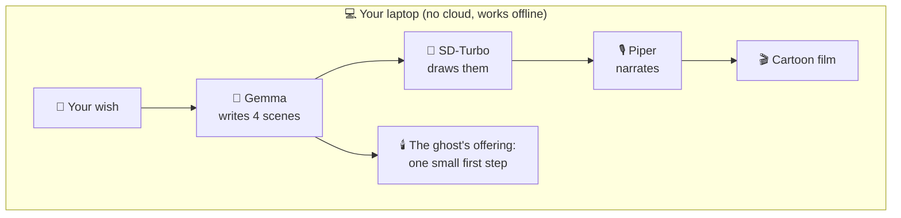

# 🎃 Ofrenda of Maybe

**Whisper a future you hope for. A friendly ghost from that future turns it into a short cartoon film, entirely on your own laptop.**

Built for the [Hacktoberfest Open-Source AI Challenge, Week 4: Ghost in the Machine](https://dev.to/challenges/hacktoberfest-week4-2026-10-26).

<!-- Add a screenshot or GIF here:  -->

## How it works



Scenes 1-3 tell your wish as a cheerful story. Scene 4 is the **ghost**: your future self, who remembers the first small step that started it all. That step also appears as its own card, so a daydream becomes something you can do today.

## Features

- 🎬 4-scene cartoon film with captions and slow zoom
- 🕯️ "The ghost's offering": one concrete first step
- 🎙️ 4 narrator voices (storyteller, cheerful, British, ghostly whisper)
- 👻 Halloween UI: cobwebs, a dangling spider, floating ghosts, a flickering title
- 😱 A ghost may pop out while you type. Turn it off (and the scream) in **⚙️ Settings**. It also stays off if your system asks for reduced motion.
- 💌 A feedback box. Notes are saved to `feedback.csv` on your own machine and never uploaded.

## Run it

```bash
git clone https://github.com/Ankita562/ofrenda-of-maybe.git
cd ofrenda-of-maybe
python -m venv .venv
source .venv/Scripts/activate          # Git Bash. PowerShell: .venv\Scripts\Activate.ps1
pip install torch --index-url https://download.pytorch.org/whl/cu126
pip install -r requirements.txt
ollama pull gemma3:4b
python -m piper.download_voices en_US-lessac-medium en_US-amy-medium en_GB-alba-medium en_US-ryan-medium --data-dir voices
python app.py
```

Open <http://127.0.0.1:7860/?__theme=dark>. Needs Python 3.10-3.12, [Ollama](https://ollama.com), and ideally an NVIDIA GPU with 4 GB+ VRAM (built on an RTX 3050 Laptop). Films are saved in `outputs/`.

**Offline:** after the first run (which downloads the models), run `HF_HUB_OFFLINE=1 python app.py` and turn Wi-Fi off. Everything, including fonts, loads from your machine.

## Open models used

| Job | Model / tool |
|---|---|
| Storyboard | [Gemma 3 4B](https://ollama.com/library/gemma3) via Ollama |
| Images | [SD-Turbo](https://huggingface.co/stabilityai/sd-turbo) via 🤗 diffusers |
| Voice | [Piper](https://github.com/OHF-Voice/piper1-gpl) |
| Video / UI | MoviePy / Gradio |

**Why open?** Hopes are personal, so they never leave your machine. No API key, no cost, and you can swap any model with one line.

## Limits

SD-Turbo is fast but rough: crowds, hands and text often fail, so scenes stay simple. Results vary with the small 4B model. The video is a slideshow with a slow zoom, not full animation. Models keep their own licenses (Gemma, SD-Turbo, each Piper voice); check them before commercial use. Code: MIT.